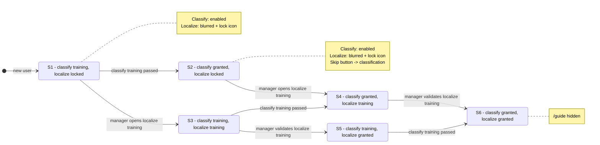

# Guide page: training access by right status

Status: draft, for discussion.

## Mapping

- "Training done" means the right's status is `granted`.
- "Has localize right" means `localize_status` is `training` or `granted`.

## State machine

## What the guide shows

| State | `classify_status` | `localize_status` | Classify module | Localize module | Skip button | Guide page |
| --- | --- | --- | --- | --- | --- | --- |
| S1 | `training` | `locked` | enabled | blurred + lock | no | visible |
| S2 | `granted` | `locked` | enabled | blurred + lock | yes | visible |
| S3 | `training` | `training` | enabled | enabled | no | visible |
| S4 | `granted` | `training` | enabled | enabled | no | visible |
| S5 | `training` | `granted` | enabled | enabled | no | visible |
| S6 | `granted` | `granted` | - | - | - | hidden |

Users who existed before the roles migration start in S2 or S6, because the migration set their classify status to granted.

## Decisions

1. The Skip button shows only in S2. It links to the classify queue (`/classify`).
2. In S6 the sidebar has no Training section, and every `/guide` path sends to the home page (`/`).
3. Only the statuses count. The role (`admin`, `annotation_manager`) does not change what the guide shows.
4. A module whose right is `locked` is blurred with a lock icon, for classify as for localize. Opening its page by URL sends back to `/guide`.
5. The Basics module is always visible and enabled while the guide is visible.
6. Until the classify training is passed (`can_classify` false: classify not `granted`, not `admin`), the guide is the only page. The home page and every other path send to `/guide`, and the sidebar shows only the Training section. This covers S1, S3 and S5.

The rules live in `frontend/src/utils/guideAccess.ts`; the route guards are `frontend/src/components/routing/RequireGuide.tsx` and `frontend/src/components/routing/RequireClassifyTraining.tsx`.
