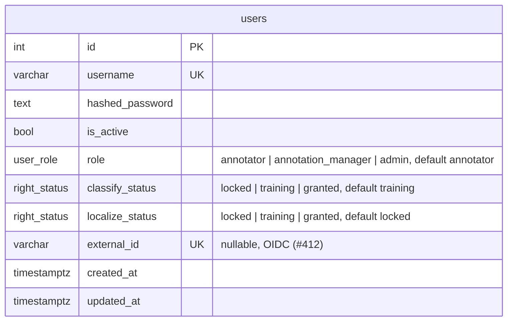
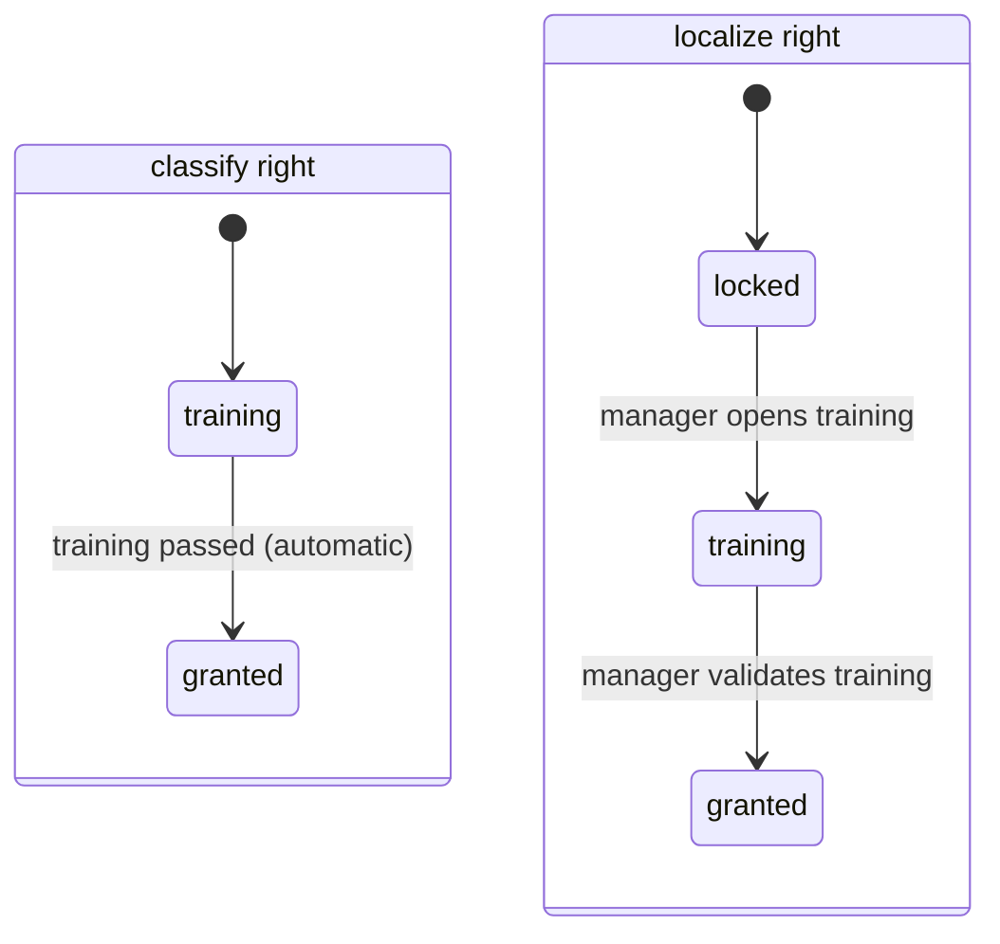

# User roles and rights: database schema

Status: draft, for discussion in #401.

## Model

- Each user has one role, stored as an enum. The default is `annotator`.
- Each user has one status per right: `classify` and `localize`.
- A right is usable only when its status is `granted`.

| Right | Default | How it moves |
| --- | --- | --- |
| `classify` | `training` | Training is open to every user. Passing it grants the right automatically. |
| `localize` | `locked` | An `annotation_manager` opens the training, then validates it to grant the right. |

The role is a ladder (`annotator` < `annotation_manager` < `admin`), so an `admin` can do every `annotation_manager` task.

## Schema

```sql
CREATE TYPE user_role    AS ENUM ('annotator', 'annotation_manager', 'admin');
CREATE TYPE right_status AS ENUM ('locked', 'training', 'granted');

CREATE TABLE users (
  id               SERIAL PRIMARY KEY,
  username         VARCHAR(50) NOT NULL UNIQUE,
  hashed_password  TEXT NOT NULL,
  is_active        BOOLEAN NOT NULL DEFAULT TRUE,
  role             user_role    NOT NULL DEFAULT 'annotator',   -- replaces is_superuser
  classify_status  right_status NOT NULL DEFAULT 'training',
  localize_status  right_status NOT NULL DEFAULT 'locked',
  external_id      VARCHAR(255) UNIQUE,                         -- OIDC link later (#412)
  created_at       TIMESTAMPTZ NOT NULL DEFAULT now(),
  updated_at       TIMESTAMPTZ
);
```



## Right statuses



## Choices

1. One status column per right, not booleans. Three booleans (`can_classify`, `can_localize`, `can_access_localize_training`) allow impossible combinations, such as "can localize" without training access. A status column does not.
2. Code checks `user.localize_status == 'granted'` where it checks `user.can_localize` today. The `get_current_localizer` dependency keeps its shape, and a `get_current_classifier` dependency is added the same way.
3. Only the current rights are stored. There is no history of who changed a right, or when.
4. Which data a user sees (tags, full access) is not part of this design. When the tags arrive, a non-admin user with no tag sees nothing, so the tags migration gives existing users their tags.
5. The right is named `classify`, not `annotate`, because localizing is also annotating.

## API

| Action | Who |
| --- | --- |
| List and read users | `annotation_manager`, `admin` |
| Change `classify_status` / `localize_status` of an `annotator` | `annotation_manager`, `admin` |
| Change any other field, or edit a manager or an admin | `admin` |
| Create, delete a user, change a password | `admin` |
| Classify (`classify-submit`, `annotations/sequences/bulk`) | `classify_status = granted`, or `admin` |
| Localize (detection annotation writes, auto-annotate) | `localize_status = granted`, or `admin` |

`UserRead` also returns `can_classify` and `can_localize`, computed from the role and the statuses.

The database stores the enum names in upper case (`ANNOTATOR`, `GRANTED`), like the other enums of the project. The API reads and writes the lower-case values.

## Migration

| Today | After |
| --- | --- |
| `is_superuser = true` | `role = 'admin'` |
| `is_superuser = false` | `role = 'annotator'` |
| every existing user | `classify_status = 'granted'` |
| `can_localize = true` | `localize_status = 'granted'` |
| `can_localize = false` | `localize_status = 'locked'` |

The `is_superuser` and `can_localize` columns are dropped after the migration.
